= KFSM Visualization
:project-version: 2.0.1

image:https://github.com/infosmid-org/kfsm-viz/actions/workflows/snapshot.yml/badge.svg[Build Status,link=https://github.com/infosmid-org/kfsm-viz/actions/workflows/snapshot.yml]
image:https://img.shields.io/maven-central/v/org.infosmid/kfsm-viz.svg[Maven Central,link=https://central.sonatype.com/artifact/org.infosmid/kfsm-viz]
image:https://img.shields.io/badge/License-Apache%202.0-blue.svg[License,link=LICENSE]

This work is licensed under link:https://www.apache.org/licenses/LICENSE-2.0.html[Apache License 2.0]

This project will explore many ways to visualize KFSM definitions.

The Kotlin source containing the FSM is parsed with an ANTLR parser generated at build time from the Kotlin grammar
(`src/main/antlr`, taken from the `develop` branch of https://github.com/Kotlin/kotlin-spec[kotlin-spec], see `KOTLIN_SPEC_COMMIT`).
No external grammar tools need to be built or installed. Run `./download-kotlin-spec-tools.sh` to update the grammar from kotlin-spec `develop` and rebuild.

== Getting Started

The library is only needed to generate documentation and diagrams from your tests, so add it using the `testImplementation` configuration and not `implementation`.
This keeps it off your production classpath.

=== Gradle Groovy DSL

[source,groovy,subs="attributes+"]
-----
repositories {
    mavenCentral()
}
dependencies {
    testImplementation 'org.infosmid:kfsm-viz:{project-version}'
}
-----

=== Gradle Kotlin DSL

[source,kotlin,subs="attributes+"]
-----
repositories {
    mavenCentral()
}
dependencies {
    testImplementation("org.infosmid:kfsm-viz:{project-version}")
}
-----

=== Gradle Version Catalog

Declare the library in `gradle/libs.versions.toml`:

[source,toml,subs="attributes+"]
-----
[versions]
kfsm-viz = "{project-version}"

[libraries]
kfsm-viz = { module = "org.infosmid:kfsm-viz", version.ref = "kfsm-viz" }
-----

Then reference it from `build.gradle` (Groovy DSL):

[source,groovy]
-----
dependencies {
    testImplementation libs.kfsm.viz
}
-----

or from `build.gradle.kts` (Kotlin DSL):

[source,kotlin]
-----
dependencies {
    testImplementation(libs.kfsm.viz)
}
-----

=== Generating the artifacts

You can implement a test method to generate the required statemachine model artifacts, or you can configure the link:https://github.com/infosmid-org/kfsm-viz-plugin[kfsm-viz-plugin] for Gradle to produce visualizations.

=== PlantUML Statemachine Diagram

By parsing the source code we can extract the details of the guard expressions and actions.
This requires that you place one definition inside of one class.
There is a chance for the parser based solution to misbehave.
We request that you log an issue with the problematic FSM definition.

[source,kotlin]
----
@Test
fun produceVisualizationTurnstileFSM() {
    println("== TurnStile")
    val visualisation = parseStateMachine("TurnstileFSM", File("src/test/kotlin/Turnstile.kt"))

    val plantUmlFile = File("generated-parsed", "turnstile.plantuml")
	plantUmlFile.writeText(plantUml(visualisation, true)) // <1>
    val plantUmlSimpleFile = File("generated-parsed", "turnstile-simple.plantuml")
	plantUmlSimpleFile.writeText(plantUml(visualisation, false)) // <2>
}
----

<1> Detailed Included in State Diagram
<2> Detail like actions and guards ignored

=== AsciiDoctor State Table from VisualStatemachineDefinition

[source,kotlin]
----
@Test
fun produceVisualizationTurnstileFSM() {
    println("== TurnStile")
    val visualisation = parseStateMachine("TurnstileFSM", File("src/test/kotlin/Turnstile.kt"))
    File("generated-parsed", "turnstile.adoc").writeText(asciiDoc(visualisation))
}
----

== Generated from parsed VisualStateDefinition

We generated an asciidoc table as well as a plantuml statemachine model.

=== Simple Turnstile FSM

link:./src/test/resources/SimpleTurnstile.kt[SimpleTurnstile.kt]

==== Simple State Diagrams

===== PlantUML

image::simple-turnstile-simple.svg[width=40%]

===== Mermaid

==== Detailed State Diagrams
===== PlantUML
image::simple-turnstile.svg[width=50%]

===== Mermaid

include::generated-parsed/simple-turnstile.adoc[]

=== Paying Turnstile FSM

link:./src/test/resources/PayingTurnstile.kt[PayingTurnstile.kt]

==== Simple State Diagram

===== PlantUML
image::paying-turnstile-simple.svg[width=60%]

===== Mermaid

==== Detailed State Diagram
===== PlantUML
image::paying-turnstile.svg[width=90%]

===== Mermaid

include::generated-parsed/paying-turnstile.adoc[]

=== Secure Turnstile FSM

link:./src/test/resources/SecureTurnstile.kt[SecureTurnstile.kt]

==== Simple State Diagram

===== PlantUML
image::secure-turnstile-simple.svg[width=50%]

===== Mermaid

==== Detailed State Diagram
===== PlantUML
image::secure-turnstile.svg[width=90%]
===== Mermaid

include::generated-parsed/secure-turnstile.adoc[]

=== Packer Reader FSM

link:./src/test/resources/PacketReader.kt[PacketReader.kt]

==== Simple State Diagram
===== PlantUML
image::packet-reader-simple.svg[width=60%]
===== Mermaid

==== Detailed State Diagram

===== PlantUML

image::packet-reader.svg[width=90%]

===== Mermaid

include::generated-parsed/packet-reader.adoc[]

== FAQ

=== What is with the semi-colons?

For guard expression we have decided the keep them on one line and we made the decision to print the implicit semi-colons to remove ambiguity.
